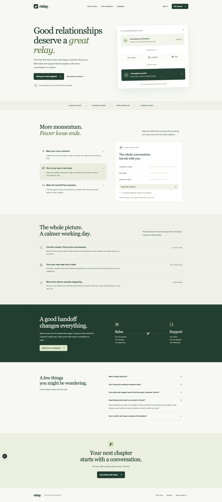

<div align="center">

# relay.

**A simple, honest CRM for B2B sales and support teams.**

Leads, customers, deals, quotations, forecasts, follow-ups and support records in one connected workspace.




</div>

---

## Local prototype status

Relay is a local working prototype with real persistence and manually reviewed customer workflows. The recorded automated browser run is incomplete. Container configuration and browser tests remain in the repository; their presence does not certify deployment or a complete test-suite pass.

The [current CRM audit](docs/CRM_AUDIT_2026-10-22.md) compares major features with commercial and open-source CRMs and records remaining gaps. [CHECKLIST.md](CHECKLIST.md) separates delivered code from observed manual journeys.

## ⚡ Quick start

You need **Python 3.11 or 3.12** (or [uv](https://docs.astral.sh/uv/)) and **Node.js 22+**.

```sh
git clone https://github.com/terabhaicoder/relay-crm.git
cd relay-crm
python3 scripts/dev.py
```

That is all. On the first run, the script:

1. creates `backend/.venv` and installs the Python packages,
2. runs `npm ci` in `frontend/`,
3. starts the API and the web app together.

| What | Where |
| --- | --- |
| 🖥️ Web app | http://127.0.0.1:3007 |
| ⚙️ API | http://127.0.0.1:8010 |
| 📘 API docs (Swagger) | http://127.0.0.1:8010/api/v1/docs |

On an existing installation, restart the local API so its checksum-checked migration runner applies `0006_quotations.sql` (quotations/lines/events) and migrations `0007`–`0010` (saved views, durable automations, custom fields and lead capture). Existing migrations and records are retained. These additions require no new runtime dependency or external provider credentials.

Open the web app and **sign up** to create your own workspace. No external accounts or API keys are needed. Press `Ctrl+C` to stop both servers.

> **Tip:** Use `python3 scripts/dev.py --port 4000 --api-port 9000` to change ports, or set `CRM_PYTHON` to use a Python you have already prepared.

---

Local workflow jobs run automatically with the development API. Keep it running for scheduled steps; queued work survives restart. No Redis/Celery is needed for this single-instance profile. Test mode disables the background loop for deterministic tests.

## ✨ What you can do

| Area | Features |
| --- | --- |
| 📝 **Lead forms** | Settings → Lead capture creates a local inquiry page with consent, duplicate protection, round-robin assignment and real submission counts. |
| 🧩 **Custom fields** | Typed optional fields on five record types, with versioned saves, history and conversion/merge handoff. |
| ⏱️ **Scheduled workflows** | Ordered task, notification and owner-assignment steps with delays, execution links and retry/cancel. |
| 🎯 **Leads** | Capture leads, find and merge duplicates (with a same-phone warning), qualify, and convert into a linked contact + company + deal in one step. Converting twice never creates duplicates. |
| 📊 **Pipeline** | Kanban board and table views, drag deals between stages, multiple pipelines, stage history, required loss reasons. Won/lost deals stay out of open-pipeline totals. |
| 🧾 **Quotations** | Create deal-linked drafts with exact server totals, issue locked terms, record customer acceptance/decline and optionally mark the deal won atomically. Print the saved document. INR estimates exclude tax; acceptance is not a signature or payment. |
| ✅ **My Day & Tasks** | Tasks, calls, meetings and notes linked to customer records, plus a calendar view. |
| 🎧 **Support** | Tickets linked to company/contact/deal. Internal notes are kept separate from customer reply drafts. |
| ⚡ **Automations** | Eleven supported record-event triggers, compatible conditions, persisted task/notification actions and execution logs. Durable ordered steps, owner assignment, delays and retry/cancel are available. |
| 📥 **Import / Export** | CSV import with row-level checks, deduplication and a downloadable error file. Exports are protected from spreadsheet-formula injection. |
| 📎 **Attachments** | PDF, image, text and CSV files on records (10 MB limit) with permission-checked downloads. |
| ✉️ **Email workspace** | Start a linked draft from a CRM record, apply a template, and reopen it from that record. Name/email/company placeholders use the linked context. Everything remains unsent; Gmail/sending is deferred and no mailbox adapter is implemented. |
| 👥 **Team & roles** | Invitations, roles, read-only users, and own-record visibility for sales reps. Each workspace is fully isolated — another workspace's record ID returns 404. |
| 📈 **Reports** | Database-backed dashboard plus close-date forecast, weighted estimates, monthly results, pipeline/date filters and paginated deal drill-through. Overdue/undated deals are separate attention lists. Indian monetary formatting preserves paise, such as ₹1,25,000.50. |

---

## 🧱 Tech stack

```
┌──────────────────────────┐        ┌───────────────────────────┐        ┌────────────┐
│  Next.js 16 · React 19   │  HTTP  │  FastAPI · SQLAlchemy 2   │  SQL   │   SQLite   │
│  TypeScript (typed API)  │ ─────▶ │  routers → services →     │ ─────▶ │ backend/   │
│  frontend/  :3007        │        │  repositories → models    │        │  erp.db    │
└──────────────────────────┘        │  backend/  :8010          │        └────────────┘
                                    └───────────────────────────┘
```

- **Backend:** FastAPI, SQLAlchemy 2, Pydantic 2. Numbered SQL migrations run on startup, with checksums.
- **Frontend:** Next.js App Router with a TypeScript client generated from the OpenAPI schema.
- **Database:** a real, persistent SQLite file (`backend/erp.db`). Startup never wipes existing data.
- **Safety built in:** real session auth, shared tenant/owner scoping, server validation, version checks and exact Decimal calculations. Supplied idempotency keys protect supported CRM creates; quotations and saved-view creation require them. Universal required-key enforcement remains incomplete.
- **Module ownership:** `commercial` owns quotation tables, `views` owns private presets, and CRM deal changes from quotation acceptance use the CRM service in the same transaction.

The private saved-view API and stored presets remain available, but saved-view controls are not exposed in the current list UI. Search, filters, sorting and pipeline controls remain available.

### Project layout

```
relay-crm/
├── backend/            FastAPI app, migrations and tests
│   ├── app/
│   ├── local_migrations/
│   └── tests/
├── frontend/           Next.js web app and Playwright tests
│   └── src/
├── scripts/dev.py      One-command local start (sets everything up on first run)
├── docs/               Deployment guide, demo script, startup notes
└── docker-compose.yml  Container setup
```

---

## 🎬 Try sample data

New workspaces start empty. You can either use the **sample data** button inside the app (all records are clearly marked as fictional), or create a demo owner at startup:

```sh
DEMO_SEED=true DEMO_PASSWORD='choose-a-password' python3 scripts/dev.py
```

The demo login email is `owner@demo.local` unless you set `DEMO_EMAIL`. Never turn on demo data in production.

A local walkthrough is in [docs/HACKATHON_DEMO.md](docs/HACKATHON_DEMO.md).

---

## Historical infrastructure

Container configuration and [docs/DEPLOYMENT.md](docs/DEPLOYMENT.md) are retained for future deployment work. Fresh-container startup, HTTPS, restoration and production readiness have not been certified for this version.

---

## 🧪 Validation recorded

The latest local checks completed **215 backend tests with one optional integration test deselected**, **seven backup tests**, **mypy for 69 source files**, frontend **ESLint, TypeScript, five proxy tests and an isolated production build**. Generated API contracts matched the backend, and the production npm dependency audit reported zero vulnerabilities at the time of this check. These checks do not certify every browser journey.

Manual Chrome review has verified signup → lead conversion → company/contact/deal → quotation create/issue/record acceptance and won-deal update → forecast at ₹1,25,000.50; also company overview → dated follow-up → My Day/Calendar. Also verified a contact-linked draft with template substitution and preserved association after reopening, and a company-linked support ticket with internal note and persisted Resolved status. Campaign review verified adding/removing an existing converted lead with correct 1/1 conversion counts and the original lead retained. A leads.created rule produced a correctly linked one-day follow-up that was completed in My Tasks. The private contact-view save/reload/apply/update/delete lifecycle was verified before its list controls were removed. These observations do not certify every automation trigger or campaign conversion scenario, and no complete automated browser-suite pass is claimed.

For the exact evidence, pending journeys and historical results, read [CHECKLIST.md](CHECKLIST.md), [CHANGELOG.md](CHANGELOG.md) and the [CRM audit](docs/CRM_AUDIT_2026-10-22.md). Backend tests exercise actual API/database behavior with temporary SQLite; isolated test doubles cover specific failure paths and are not runtime integrations.

---

## 🛠️ Manual setup (if you prefer)

```sh
python3.11 -m venv backend/.venv
backend/.venv/bin/python -m pip install -r backend/requirements-local.txt
(cd frontend && npm ci)
python3 scripts/dev.py
```

**Common issues**

- *"Python 3.11 or 3.12 is required"* — install one of them, or install `uv` and run again.
- *Python packages failed to install* — delete `backend/.venv` and run `python3 scripts/dev.py` again.
- *Port already in use* — pass `--port` and `--api-port`.

---

## 🗺️ Roadmap

- Externally hosted lead forms, production abuse protection and advanced routing; local capture and round-robin assignment are implemented
- Real mailbox/calendar integration when that deferred scope resumes
- Support intake, delivered replies, SLA/escalation and customer self-service
- Shared views, bulk actions, custom-field filtering/import/export, branching and recurring automations
- Forecast targets/snapshots and configurable reporting; verified connector/API/webhook workflows
- PostgreSQL + Redis/Celery for future multi-instance scale
- ERP modules (accounting, inventory, GST, payroll) — planned in [PLAN.md](PLAN.md), **not built yet**

